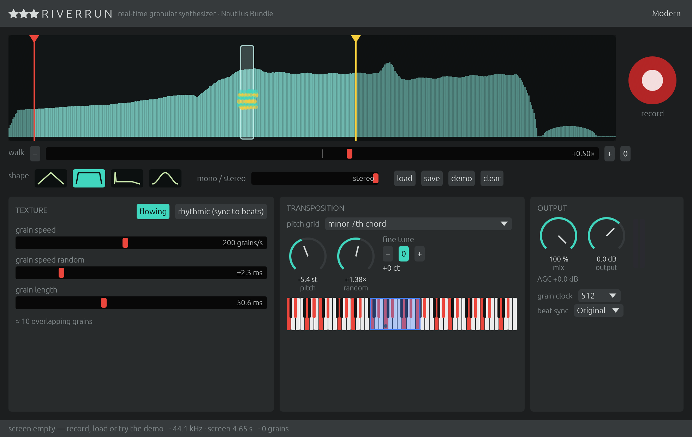
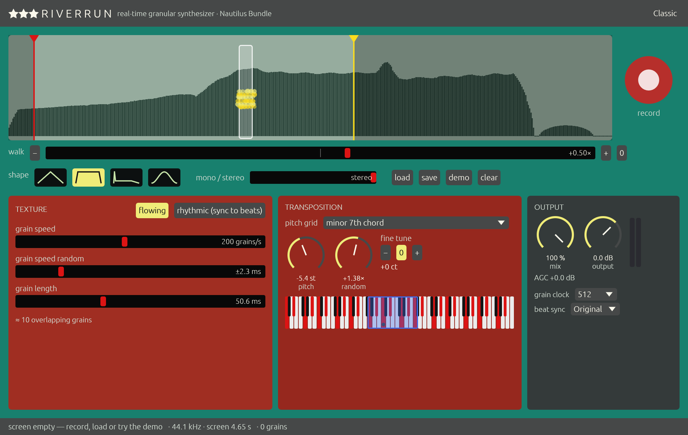
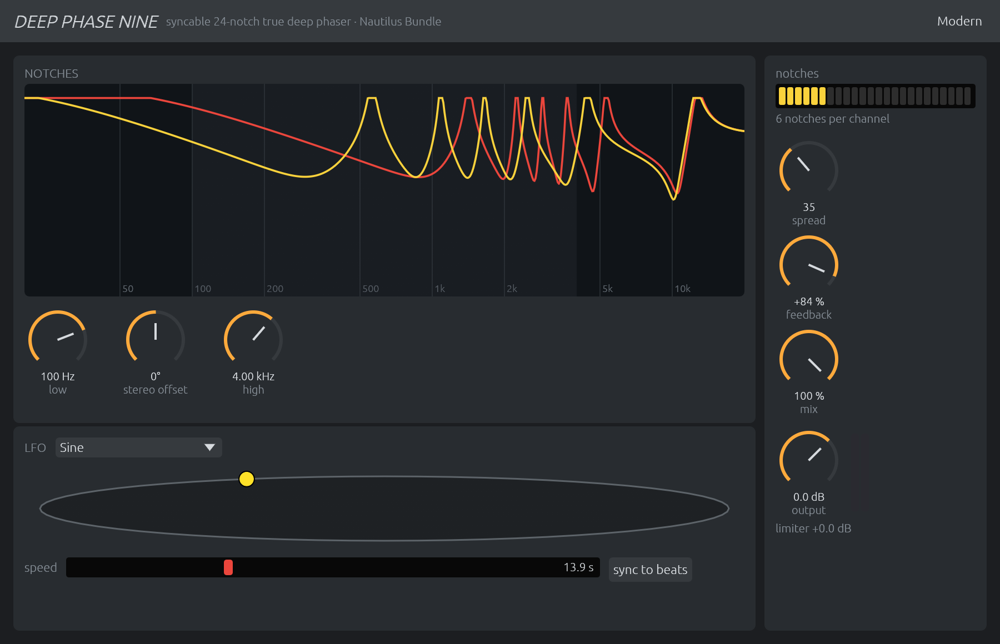
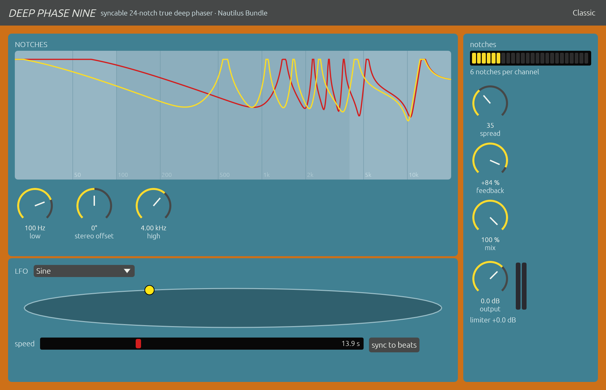
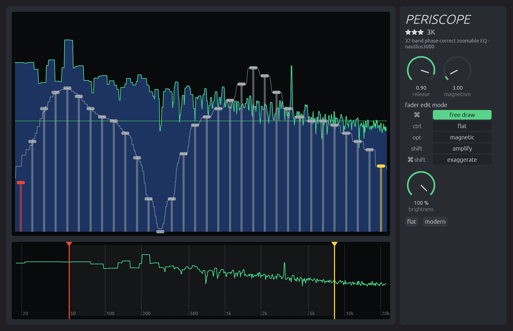
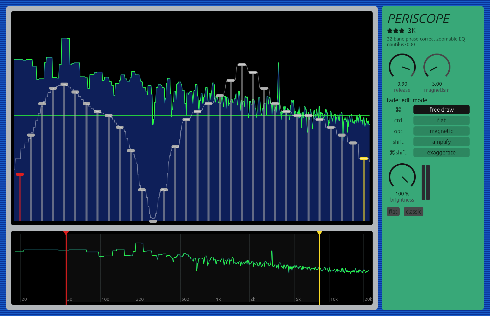

# nautilus3000

```
 _  _   _  _   _ _____ ___ _   _   _ ___   ____ __   __   __
| \| | /_\| | | |_   _|_ _| | | | | / __| |__ //  \ /  \ /  \
| .` |/ _ \ |_| | | |  | || |_| |_| \__ \  |_ \ () | () | () |
|_|\_/_/ \_\___/  |_| |___|____\___/|___/ |___/\__/ \__/ \__/

  AUDIO EASE NAUTILUS BUNDLE 2000–2013 • REBUILT FROM THE ORIGINAL BINARIES
                 RiverRun3K · DeepPhaseNine3K · Periscope3K
```

A modern recreation of **Audio Ease's Nautilus Bundle**: the three "watery"
plug-ins that started out in 2000 as MAS plug-ins for Digital Performer on
Mac OS 9 and were sold until 2013. Each one is rebuilt in Rust from the
original machine code, with the [truce](https://github.com/truce-audio/truce)
framework, and has a new resizable editor with a Modern and a Classic theme.
It follows [th0nk3000](https://github.com/nagualcode/th0nk3000), the rebuild of
Thonk, Audio Ease's free granular toy by the same author as RiverRun.

| Plug-in | What it is | Engine |
|---|---|---|
| [**RiverRun3K**](#riverrun3k--real-time-granular-synthesizer) | real-time granular synthesizer: freeze audio, scatter it as pitched grains | bit-identical to the original, 57/57 scenarios |
| [**DeepPhaseNine3K**](#deepphasenine3k--24-notch-syncable-true-deep-phaser) | phaser with up to 24 notches, sync to beats, look-ahead limiter | bit-identical, 39/39 |
| [**Periscope3K**](#periscope3k--32-band-zoomable-phase-correct-eq-and-spectroscope) | 32-band linear-phase EQ whose band range you zoom with two needles, over a live spectrum | bit-identical, 28/28 |

"Bit-identical" means: the original 2.6.4 machine code is *executed* in a CPU
emulator, fed the same audio and the same settings as the Rust engine, and the
two outputs are compared float for float. They match. See
[How faithful is it?](#how-faithful-is-it).

**Contents** — [Installing](#installing) ·
[RiverRun3K](#riverrun3k--real-time-granular-synthesizer) ·
[DeepPhaseNine3K](#deepphasenine3k--24-notch-syncable-true-deep-phaser) ·
[Periscope3K](#periscope3k--32-band-zoomable-phase-correct-eq-and-spectroscope) ·
[MIDI](#midi-control) · [Command line](#command-line) ·
[How faithful is it?](#how-faithful-is-it) · [Building](#building) ·
[Repository](#repository) · [Credits](#license-and-credits)

---

## Installing

The plug-ins build as **AU** (macOS), **VST3** and **CLAP**, plus a
standalone app each. Until release builds are published, build them yourself
(see [Building](#building)):

```bash
cargo truce install --au2 --user        # AU only, into ~/Library/Audio/Plug-Ins/Components
cargo truce install --clap --vst3 --user
```

Then rescan in your host. In Logic and GarageBand they appear under
*Audio Units ▸ Jardim Sonoro*; in Live, Reaper, Bitwig and Cubase under the
same vendor.

**Which slot?** All three are **effects** that also accept MIDI. Put them on
an audio track (or bus) as an insert. To play them from a keyboard (see
[MIDI control](#midi-control)), route a MIDI track to the plug-in. In Logic,
MIDI to an effect needs the plug-in loaded in an instrument slot with the
audio routed in through the side-chain menu — exactly what Audio Ease's own
manual recommended in 2003.

**Channels.** RiverRun3K: stereo out, mono or stereo in. DeepPhaseNine3K:
mono, mono→stereo and stereo. Periscope3K: mono and stereo (as the old manual
says, give PeriScope as many inputs as outputs).

**Latency.** RiverRun3K and DeepPhaseNine3K delay the signal by 300 samples
(the look-ahead of the original limiter); Periscope3K by 3072 samples, more
with host buffers above 2048 (its FFT blocks). All three report it, so hosts
with delay compensation keep everything aligned.

**Themes.** Every editor has a theme button: **Modern** (dark) or **Classic**
(the 2000 colours: Riverrun's orange, Deep Phase Nine's teal and sea,
PeriScope's blue stripes, brushed metal and green panel). The choice is saved
with the project.

---

## RiverRun3K — real-time granular synthesizer



> *Audio from the sequencer's tracks or directly from a disk file can be
> streamed into and frozen in Riverrun. Tiny particles of the audio, called
> grains, are pushed through an envelope generator, pitched and scattered across
> the output channels according to the surface controls.* — Audio Ease

### The idea

A granular synthesizer doesn't play a sound, it plays *crumbs* of it: tens to
thousands per second, each a few milliseconds to a third of a second long,
each with its own envelope, pitch and position in the stereo field. Played
densely, the crumbs fuse into a texture — a choir out of one voice, a drone out
of a guitar strum, a pulse out of a spoken word. RiverRun's twist is that it
works *live*: you catch audio from the track while it plays and turn it into a
river of grains on the spot.

### Walk-through

**1. Catch some audio.** Insert RiverRun3K on a track and play. Press the big
**●** (record): the audio streams into the **input screen** from the right,
scrolling left. Press it again and the screen freezes. Or press **load** (or
drop a WAV/AIFF on the screen), or pick from **demo & presets** — the spoken
**Voice** from Audio Ease's 2000 demo song and the presets recovered from that
song: *probeer de klant*, *probeer de klant 2*, *drumloop 3* and the demo track's
own setting. The input screen is saved inside your project.

**2. Choose where grains come from.** The translucent **Grain Glass** on the
input screen is the window grains are taken from. Drag it to the interesting
spot. Its width is the **grain length**.

**3. Let it walk.** **Walk** moves the glass by itself, in × real time:
`+1` crawls through the audio at playing speed, `−1` backwards, `0` halts it,
`0.01` is the manual's "microscope at a hundredth of normal speed". The walk
bounces between the **red and yellow needles** at the top of the screen —
drag them to fence in a word, a note, a drum hit.

**4. Shape the grains.**

| Control | What it does |
|---|---|
| **Shape** | grain envelope: Triangle (soft), Square (the default — full level, clicks add grit), Sharp attack (percussive), Cosine (smoothest) |
| **Mono / stereo** | at full stereo every grain goes hard left or hard right; towards mono the two sides fold together, and the grain rate starts to be heard as a pitch |
| **Grain speed** | grains per second, 1 to 2000 — density |
| **Grain speed random** | onset scatter: at 0 grains come like a clock (a buzz at the grain rate), turned up they come irregularly and the texture turns organic |
| **Grain length** | 1 to 340 ms. Long grains + high speed = up to ~1000 overlapping layers ("can easily crash a G3 or G4"; here it runs 60× real time) |

**5. Pitch them.** Each grain gets its own pitch, rolled like dice:

| Control | What it does |
|---|---|
| **Pitch grid** | 23 grids. *Seamless* = no grid, any pitch. The chord grids (minor / major / dominant 7th, 4- and 5-note "deluxe" chords, minor/major 9th, octaves and fifths) and scales (diatonic, chromatic, whole tone) and equal intervals (thirds to octaves) define the red keys on the keyboard |
| **Pitch** | the base pitch — the left edge of the blue band on the keyboard |
| **Random** | widens the blue band upwards; every grain picks a random pitch inside it, snapped *up* to the nearest red key |
| **Fine tune** | ± a fifth, to tune the whole thing to the song |

So a minor-7th grid with Random at zero plays one chord tone; turn Random up
and grains scatter over a whole arpeggiated minor-7th cloud.

**6. Flowing or Rhythmic.** **Flowing** is the free texture above. **Rhythmic**
locks grains to the host tempo: the grain-speed slider becomes a ruler of note
values — black fields are straight divisions (1/1 … 1/128), grey fields the
triplets between them. Add a little *Grain speed random* for stutter; a lot
for "total anarchy".

**Added in 3K** (defaults = original behaviour): **Mix** and **Output**; **Grain
clock** — the original made one grain per *host buffer*, so the same song
sounded different at different buffer sizes; here that clock is a parameter
(default 512 samples) and the sound no longer depends on the host; **Beat
sync** — *Original* (as 2.6.4) or *Tight* (sample-accurate to the host's beat
grid).

### Recipes

* **Monk choir** — record a sung or spoken phrase; grid *minor 7th*, Pitch a
  bit below centre, Random ≈ 45, Shape *Cosine*, length ≈ 200 ms, speed ≈ 180,
  Walk 0.08. Stereo full.
* **Frozen vowel** — park the glass on one vowel, Walk 0, length 80–150 ms,
  speed high, random 0 → a sustained pad of that vowel; grid *seamless* and play
  with Pitch.
* **Microscope** — Walk 0.01 across a drum loop: every transient becomes a
  long, slowly evolving smear.
* **Glitch sequencer** — Rhythmic, 1/16, Shape *Sharp attack*, short grains,
  grid *octaves and fifths* with some Random.
* **Mono buzz** — Mono/stereo at mono, random 0, speed ≈ 110: the grain rate
  is heard as a low tone under the material.

Classic theme:



---

## DeepPhaseNine3K — 24-notch syncable true deep phaser



> *A true phaser that offers unprecedented control and visual feedback. Sweep
> up to 24 notches per channel with a versatile LFO while Deep Phase Nine plots
> their motion in real time.* — Audio Ease

### The idea

A phaser adds the signal to a copy of itself passed through all-pass filters:
where the copy comes out in opposite phase, frequencies cancel — **notches**.
Sweep the filters and the notches glide up and down the spectrum: the
"whoosh". A classic analogue six-stage phaser makes three notches; Deep Phase
Nine makes up to **24 per channel**, lets you space them, sharpen them into
whistling resonances, sync the sweep to the beat, and shows you all of it.

### Walk-through

**The notches display** (top) draws the response of both channels: yellow =
left, red = right. The shaded band is the sweep range.

| Control | What it does |
|---|---|
| **Low / High** | the lower and upper frequency of the sweep |
| **Stereo offset** | how far the right channel's notches are from the left's, −180…180°. At 0 they overlap; 90° gives a wide, swirling stereo image. (Only with stereo outputs) |

**The LFO** (bottom) moves the notches. The **oval** shows its phase as the
yellow ball (top half sweeping up, bottom half down).

| Control | What it does |
|---|---|
| **LFO shape** | *Sine* (smoothest), *Triangle*, *Sample & Hold* (jumps to random positions — glassy, robotic), *OneShot Sine* / *OneShot Triangle* (travel once to a socket and stay) |
| **Speed** | free: from 1/256 Hz (one sweep every four minutes) up to 64 Hz; with **sync to beats** the slider becomes note values from 1/32 to 32 bars, including dotted and triplet values |
| **Ball** | drag it to move the notches by hand (the LFO waits while you hold it) |
| **Socket** | with a one-shot shape, alt-drag on the oval places the ring where the ball stops; the one-shot direction picks up, down or stop |

**The right column** shapes the notches:

| Control | What it does |
|---|---|
| **Notches** | 1–24 notches per channel (click/drag the strip) |
| **Spread** | the distance between notches; low = clustered comb, high = spread across the range |
| **Feedback** | −95…+95 %. Positive sharpens the **notches**, negative turns them into **peaks**; near the ends they ring and whistle — self-oscillation, kept in check by the original look-ahead peak limiter (its gain reduction is shown under the meter) |
| **Mix** | the level of the phased signal added to the dry one; the display fades with it |
| **Output** | (3K) output trim |

### Recipes

* **Classic 70s phaser** — 3 notches, Spread ≈ 35, Feedback ≈ +50 %, Sine,
  Speed ≈ 0.3 Hz, Low 200 Hz, High 3 kHz.
* **Jet** — 24 notches, Spread low, Feedback +90 %, Triangle, slow.
* **Glass sequencer** — Sample & Hold, sync to beats at 1/16, Feedback −80 %
  (peaks), 6–8 notches: every sixteenth a new resonant chord.
* **Transition riser** — OneShot Sine with the socket at the top, sync to
  beats at 4 bars; automate the shape at the start of the build.
* **Stereo widener** — 2–4 notches, Mix 50 %, Stereo offset 90°, very slow.

Classic theme:



---

## Periscope3K — 32-band zoomable phase-correct EQ and spectroscope



> *PeriScope is a flexible and phase-correct 32 band equalizer that offers
> incredibly sharp +36 to −144 dB bands. A real-time frequency analysis is
> displayed directly beneath your faders so you can grab your audio exactly
> where you see it.* — Audio Ease

### The idea

A graphic EQ has its bands nailed to fixed frequencies. PeriScope's 32 bands
are spread over **whatever range you choose** with two needles: the whole
spectrum, or 20–400 Hz for surgery on the low end, or 2.9–3.1 kHz to take out
one whistle. Each band is extremely steep — a fader at the bottom removes its
band completely while the neighbours stay intact — and the filter is
**linear-phase**: every frequency is delayed by exactly the same time, so
cutting and boosting never smear transients or shift phase between bands.
Behind the faders, the spectrum of the output is drawn live, so you see what
you are grabbing.

### Walk-through

**The overview** (bottom screen) always shows the whole spectrum, 18 Hz to
Nyquist. Its **red needle** sets where the faders begin, the **yellow needle**
where they end; drag them (the frequencies are shown while you do).

**The fader screen** (top) shows only what lies *between* the needles, cut into
32 bands:

* the **red fader** (leftmost) is a **low pass** — everything from 0 Hz up to
  the first band;
* the **yellow fader** (rightmost) is a **high pass** — everything from the
  last band up to Nyquist;
* the 30 **grey faders** are band passes in between.

So with all grey faders at 0 dB, the red and yellow faders alone make a
smooth two-sided filter whose corners you move with the needles.

The **thin green line** is 0 dB: with every fader on it, output = input.
Faders go from −∞ (the bottom: band removed) to +34 dB, with fine steps near
0 dB and coarse ones at the extremes (−96, −48, −40 … −8, 0, +4 … +34 dB).
While you drag, a label shows the band's centre frequency and gain; it fades
a few seconds after you let go. The thin white line is the filter's actual
response.

**How the bands are spaced.** PeriScope tries to give the bands a constant
*musical* width (a constant ratio, like a graphic EQ). But a band can't be
narrower than one FFT bin — about 11 Hz at 44.1 kHz — so in low ranges the
lower bands get equal widths in Hz and switch to constant ratios above
352 Hz. If you drag the needles too close for 30 bands, they **push each
other away**: the one you're not holding moves.

**The spectroscope.** The **green** graph is the instantaneous (peak-type)
spectrum, the **blue** one an average. **Display release** sets how slowly the
blue graph follows: low = as fast as the green, high = slow and smooth.
**Brightness** dims the green graph and lines.

**Fader edit modes** — how a drag in the fader screen moves the faders. Click a
mode, or hold its key while dragging (release the key and the clicked mode
returns):

| Mode | Key | A drag… |
|---|---|---|
| **Free draw** | ⌘ | sets the fader under the pointer; sweep across to *draw* a curve |
| **Flat** | ctrl | puts all faders in one horizontal line at the pointer's height (drag it to the green line to reset) |
| **Magnetic** | option | pulls the neighbours along with a smooth (raised-cosine) falloff; **Magnetism** = how many faders wide |
| **Amplify** | shift | moves the whole curve up or down without changing its shape — an overall gain |
| **Exaggerate** | ⌘ shift | scales all faders by the same factor: pushing up exaggerates the curve, pulling down flattens it |

**flat** (under the knobs) resets all 32 faders to 0 dB.

### Recipes

* **Low-end surgery** — needles at ~20 Hz and ~400 Hz: 32 bands for the bass
  alone (about 12 Hz each); separate kick and bass, tame one boomy room mode,
  while everything above 400 Hz passes untouched (the yellow fader at 0 dB).
* **Brick-wall high-pass** — red needle at 30 Hz, red fader to the bottom:
  nothing under 30 Hz survives, in phase, without touching 40 Hz.
* **Kill a whistle** — find the line in the overview (a TV's 15.7 kHz, a hum
  harmonic); put the needles close around it; pull down only the band it falls
  in. A ~10 Hz-wide hole, the rest of the mix untouched.
* **Mastering tilt** — needles wide; draw a gentle curve in Free draw, then
  Exaggerate / Amplify to dial its strength and level.
* **Spectral gate / "telephone"** — red and yellow faders at the bottom, a few
  grey ones up: only those bands pass.
* **Moving filter** — automate the needles: the whole 32-band curve slides
  along the spectrum. Or bend it with the pitch wheel (below).

Classic theme:



---

## MIDI control

As in version 2.0.2 of the bundle. Values set by MIDI hold until the
parameter is moved by the host or the editor; with the editor open they are
written into the parameters (so the host records them).

| | RiverRun3K | DeepPhaseNine3K | Periscope3K |
|---|---|---|---|
| CC 1 | mono / stereo | — | — |
| CC 11 / 12 | red / yellow needle | — | — |
| CC 13 | walk | — | — |
| CC 14 | grain speed | — | — |
| CC 15 / 16 | pitch / pitch random | — | — |
| CC 17 / 18 | speed random / grain length | — | — |
| CC 32–63 | — | — | faders 1–32 |
| CC 64 / 65 | — | — | red / yellow needle |
| notes | place the Grain Glass (note 36 = far left, 5 octaves across, wrapping) | notch count = `note mod 24 + 1` | each note plays a fader: note-on sets it to the velocity, note-off restores it (notes wrap into 60–95) |
| pitch bend | — | — | shifts both needles as a pair |
| program change | envelope shape | — | — |

The original Deep Phase Nine CCs (1 feedback, 11 low, 12 high, …) are left
to your host's MIDI learn.

A PeriScope trick from the manual: since notes play faders, a keyboard
becomes a filter instrument — hold notes to open bands, release to close them.
The bands' frequencies follow the needles, not the note names.

---

## Command line

Offline renderers, built with the plug-ins (`target/release/`):

```bash
riverrun-render input.wav out.wav --seconds 30 --grid 2 --pitch 380 --random 45 \
    --envelope 4 --length 200 --speed 180 --walk 0.08       # a monk choir
riverrun-render voice out.wav --preset "probeer de klant 2"     # Audio Ease's demo + preset
riverrun-render sung out.wav --rhythmic --bpm 112 --speed 190 --grid 11
riverrun-render --list                                      # envelopes, grids, presets

dpn-render      --scenario scenario.json out.f32            # differential-test runners
periscope-render --scenario scenario.json out.f32
```

---

## How faithful is it?

**Bit for bit.** Each engine is a translation of the i386 slice of the
2.6.4 plug-in (class names were obfuscated by the copy protection; method
names were not). The proof: the original machine code — constructors,
`InitBuffers`, `Process`, the parameter objects — runs under the Unicorn CPU
emulator, and its output is compared with the Rust engine's, value for value:

| | Scenarios | Covering | Result |
|---|---|---|---|
| RiverRun | 57 | every envelope, all 23 grids at extremes, walking both ways, needles, live recording, Rhythmic at several tempi, 64–1024-sample blocks, 1.28 M-sample runs, 44.1/48/96 kHz | 57 identical |
| Deep Phase Nine | 39 | every LFO shape, 1–24 notches, extreme feedback / spread / ranges, one-shots, sync, all layouts, 64–1024 blocks, 44.1/48/96 kHz | 39 identical |
| PeriScope | 28 | flat / random / extreme / breakpoint fader sets, widest and narrowest needles, needles pushed both ways, automation, buffers 64–4096 incl. non-powers of two, 22.05–96 kHz | 28 identical |

The quirks are part of the sound and are kept:

* **RiverRun**: one grain per buffer copied to every onset in that buffer; a
  read position accumulated in single precision; π typed as **3.1415926528**
  in the Cosine envelope; an AGC that settles at −10 dB and never comes back;
  the odd one-second "thump" when pitch + random overshoot a chord grid.
* **Deep Phase Nine**: a control rate of 123 samples; feedback smoothed on the
  left channel but not the right; an LFO written into a parameter and read
  back.
* **PeriScope**: a Hann window built on 2π typed as **6.2831853056** and the
  same 3.1415926528 in the magnetic fader mode — the same programmer's typo, in
  three places across two plug-ins; a filter kernel centred by two `memmove`s
  whose sizes are in bytes; needles that push each other through the host's
  automation.

The write-ups, with addresses, decompiled code and the emulators:
**[riverrun](reverse_engineering/riverrun/README.md)** ·
**[deepphasenine](reverse_engineering/deepphasenine/README.md)** ·
**[periscope](reverse_engineering/periscope/README.md)**. They also compare
the Mac OS 9 builds (v1.0, 2000) — same curves and the same typos, but
RiverRun's minor-7th grid had its top notes a semitone sharp, Deep Phase
Nine's sync was built differently, and PeriScope's needles had 390 steps
instead of 418.

What 3K changes, always behind a parameter or with the original as default:
Mix/Output trims, RiverRun's host-independent grain clock and Tight beat sync,
PeriScope's true latency report (the original said 3072 whatever the buffer),
modern editors and themes.

---

## Building

Requirements: Rust 1.85+, macOS 12+ (Linux and Windows builds are untested so
far), and [`cargo-truce`](https://github.com/truce-audio/truce).

```bash
cargo test --release                                   # unit + plug-in tests
cargo run --release -p periscope --bin periscope-standalone
cargo truce install --au2 --user                       # AU only
auval -v aumf RvRn JdSn; auval -v aumf DPh9 JdSn; auval -v aumf PScp JdSn   # all pass
```

Re-running a differential test needs Python 3 with `unicorn`:

```bash
python3 reverse_engineering/periscope/tools/differential_test.py \
    reverse_engineering/periscope/original_binaries/Periscope-2.6.4-VST-i386 \
    target/release/periscope-render /tmp/psc
```

## Repository

```
nautilus3000/
├── crates/mission/          # Audio Ease "Mission" pieces shared by all three:
│                            #   AGC / limiter, ring buffer, vecLib FFT, denormal flush
├── plugins/riverrun/        # RiverRun3K: engine/ (Process, grains, tables, envelopes),
│                            #   params, editor, input screen, demo voice + presets, CLI
├── plugins/deepphasenine/   # DeepPhaseNine3K: engine (phaser + process), params, editor
├── plugins/periscope/       # Periscope3K: engine (UpdateFreqs + overlap-add), params,
│                            #   editor (fader screen, overview, spectroscope)
├── reverse_engineering/
│   ├── tools/               # Ghidra script, Mach-O / PEF / BinHex helpers, asm annotator,
│   │                        #   the shared Unicorn harness
│   ├── riverrun/  deepphasenine/  periscope/
│   │                        # write-up, original binaries, decompiled code, emulator,
│   │                        #   differential test, the original panels
├── reference/               # the original material: Mac OS 9 plug-ins, manual and demo
│                            #   song, OS X installers, the Sound on Sound review, web pages
└── docs/                    # screenshots
```

## License and credits

- Modern implementation: MIT © 2026 nagualcode / Jardim Sonoro.
- Riverrun, Deep Phase Nine, PeriScope: © 1995–2013 **Audio Ease B.V.**;
  Riverrun by the maker of Thonk (Arjen van der Schoot); interface by Captain
  Video. "Thank you Mr. Barry Truax" — from Riverrun's about box.
- Audio plug-in framework: [truce](https://github.com/truce-audio/truce).
- This is an independent preservation project, not affiliated with or
  endorsed by Audio Ease.
